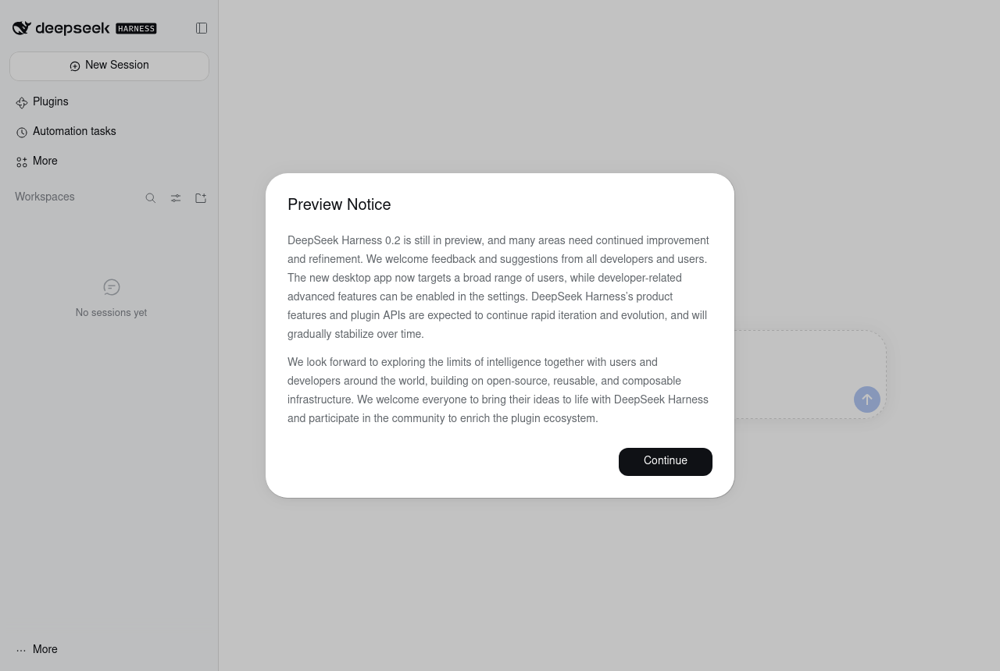

# dsh-desktop

[](https://github.com/gnoooo/dsh-linux-app/actions/workflows/ci.yml)
[](LICENSE)
[](https://github.com/gnoooo/dsh-linux-app/releases/latest)

A small Linux desktop window for [DeepSeek Harness](https://github.com/deepseek-ai/deepseek-harness).

`dsh web` already serves a complete GUI — it just happens to live in a browser tab.
This wrapper gives that same GUI a real application window: its own icon, a menu
entry, a single instance, and a backend that starts and stops with the window.
Nothing of the DSH frontend is reimplemented; the app is a launcher plus a
`WebKitGTK` view.



## Why this shape

`dsh web` prints a single line that a wrapper needs:

```
dsh web: http://127.0.0.1:3080/?token=<one-time token>
```

It supports `--port 0` (let the OS pick a free port) and `--no-open` (do not
launch a browser). So the wrapper runs

```sh
dsh web --no-open --port 0
```

reads that URL, and loads it in a `WebKitGTK` view. Closing the window stops the
whole process group of the backend.

Compared with the alternatives:

| Approach | Cost | Verdict |
|---|---|---|
| **GTK 3 + WebKitGTK** (this) | ~60 MB RSS, no bundled runtime | Uses the WebKitGTK the distribution already ships; starts instantly |
| Electron | ~200 MB per app, own Chromium | Contradicts "lightweight" |
| Tauri (Rust) | ~5 MB binary | Fine, but a large build for a wrapper this thin |
| `chromium --app=…` | ~0 | No native window control, needs Chromium installed |

The app has **no pip dependencies**: the only library it needs is PyGObject,
which is a distribution package.

## Requirements

- Linux with GTK 3 and WebKitGTK 4.1
- Python ≥ 3.11 with PyGObject
- DeepSeek Harness, reachable as `dsh` on `PATH`, or via `npx`
- Node.js **≥ 24.9** — DSH's `engines` requirement

The app needs exactly one thing from the distribution: PyGObject able to
`gi.require_version("Gtk", "3.0")` and `("WebKit2", "4.1")`. Availability is
decided by importing those, never by guessing package names, so the app works
on any distribution that has them. `dsh-desktop --check` prints the command for
*your* distribution when they are missing.

| Distribution | Install the bindings |
|---|---|
| Arch, Manjaro, EndeavourOS, CachyOS | `sudo pacman -S --needed python-gobject webkit2gtk-4.1` |
| Fedora | `sudo dnf install python3-gobject webkit2gtk4.1` |
| Debian, Ubuntu, Mint | `sudo apt install python3-gi gir1.2-webkit2-4.1` |
| openSUSE | `sudo zypper install python3-gobject typelib-1_0-WebKit2-4_1` |
| others | install PyGObject plus the typelib providing `WebKit2-4.1.typelib` |

What has actually been exercised:

| Platform | Verified |
|---|---|
| Fedora 43, KDE/Wayland | full GUI against a live `dsh web`, installer, `.desktop` entry |
| Arch Linux (rolling, Python 3.14) | package names, `install.sh`, the full unittest suite, `makepkg` build, installed `/usr/bin/dsh-desktop` |

Arch ships the same WebKitGTK 2.54 series that the GUI was verified against on
Fedora; the containerised Arch run could not open a window (no X authorisation
inside the container), so the Arch GUI was not re-rendered there.

## Install

### Any distribution (per-user install)

```sh
git clone https://github.com/gnoooo/dsh-linux-app && cd dsh-linux-app
./scripts/install.sh
```

The script checks the bindings, creates `.venv` with `--system-site-packages`,
installs the package into it, links `~/.local/bin/dsh-desktop`, and writes an
icon and a `.desktop` entry under `~/.local/share`. "DeepSeek Harness" then
appears in your application menu, and `dsh-desktop` is on your `PATH` (the
installer says so if `~/.local/bin` is not).

Run it from a terminal instead:

```sh
.venv/bin/dsh-desktop
```

Two details make this portable:

- The venv is pinned to the **system** interpreter and `uv` is told never to
  download its own Python (`UV_PYTHON_DOWNLOADS=never`). A uv-managed CPython
  cannot see the distribution's PyGObject.
- A venv left over from another distribution (different Python minor version)
  is recreated automatically, so moving a checkout between distros is safe.

The venv must be created with `--system-site-packages`, because PyGObject is a
system package. `uv tool install .` would build an isolated environment that
cannot import `gi`.

Uninstall:

```sh
./scripts/uninstall.sh          # keeps your settings and session data
./scripts/uninstall.sh --purge  # also removes WebKit profile, config, logs
```

### Arch Linux (native package)

`packaging/arch/PKGBUILD` builds a proper pacman package that installs
`/usr/bin/dsh-desktop`, the icon and the desktop entry system-wide, with
`python-gobject` and `webkit2gtk-4.1` as declared dependencies:

```sh
cd packaging/arch
makepkg -si
```

`/usr/bin/dsh-desktop` then runs on the system Python. It is the same code as
the per-user install; only the interpreter and install prefix differ.

The PKGBUILD builds from the checkout it lives in and is not AUR-ready as-is.
Before submitting it, switch the PKGBUILD to a release tarball (`source=`,
`sha256sums=`) and regenerate `.SRCINFO` so the package builds from a tagged
release rather than a local working tree.

## Releases

Tagged versions are published on the
[GitHub releases page](https://github.com/gnoooo/dsh-linux-app/releases). The
checkout works at any tag, so a specific release can be installed with:

```sh
git clone https://github.com/gnoooo/dsh-linux-app && cd dsh-linux-app
git checkout v0.1.0
./scripts/install.sh
```

## Embedding (dsh-romeo and similar launchers)

This app is a separate process, not a library: a launcher starts it, and it runs
`dsh web` itself. That makes three things flow naturally.

- **Environment** is inherited, so a launcher sets `ROMEO_LLM_KEY`,
  `OPENAI_BASE_URL`, `DSH_HOME`, … and the backend sees them. The overlay below
  reads its key with `apiKeyEnv: ROMEO_LLM_KEY`, which works unchanged.
- **Launcher flags** are passed through: anything this app does not recognise
  goes to `dsh web`, so `--patch overlay.yml` applies an extra overlay.
- **Authentication stays internal.** The app consumes the tokenised URL that
  `dsh web` prints; the launcher never has to open a browser or forward a URL.

```sh
# what a launcher runs (the overlay is optional)
dsh-desktop --dsh /path/to/dsh --patch /path/to/overlay.yml
```

`--dsh` pins the exact `dsh` binary the launcher prepared, instead of relying on
`PATH` detection. The resulting backend command line is:

```
dsh web --patch /path/to/overlay.yml --no-open --port 0
```

The order matters: `dsh web …` is rewritten to `dsh --profile web …`, and
launcher options are only parsed up to the first option the launcher does not
know. A launcher flag therefore has to precede `--no-open`; this app inserts
pass-through arguments there for you.

Useful exit codes and checks for a launcher's own `--doctor`:

| Exit | Meaning |
|---|---|
| `0` | ran and the window was closed normally |
| `1` | no `dsh`/`npx` launcher found |
| `2` | bad configuration or flags |
| `3` | GTK 3 / WebKitGTK 4.1 bindings missing |

`dsh-desktop --check` prints the launcher it would use, the Node version, the
distro's install command when bindings are missing, and exits non-zero when
something required is absent — a cheap preflight before starting a tunnel.

## How it starts DSH

The launcher is chosen in this order:

1. `command` in `config.toml`, or `--dsh`
2. `dsh` on `PATH`
3. a Node version-manager install (`~/.nvm`, `fnm`, `volta`) or `~/.local/bin`
4. `npx -y @deepseek-ai/dsh`

`--check` prints exactly what was picked:

```sh
$ dsh-desktop --check
dsh-desktop 0.1.0
python       3.14.8  (/usr/bin/python3)
gtk          3.24.52
webkitgtk    2.54.2
config       ~/.config/dsh-desktop/config.toml (absent)
launcher     /home/you/.nvm/versions/node/v24.22.2/bin/dsh
origin       PATH
node         v24.22.2
workspace    /home/you (ok)
port         0 (OS-assigned)
```

### The Node.js trap this app works around

The `dsh` shim is a `#!/usr/bin/env node` script, so whatever `node` resolves to
decides whether DSH starts at all. Two situations break naive wrappers:

- A `.desktop` launch inherits a minimal `PATH`. A distribution Node (often
  older than 24.9, e.g. Fedora's 22.x) shadows the newer one your shell uses.
- Prepending the `dsh` shim's own directory looks helpful, but that directory
  may hold the old Node that installed it.

Under an unsupported Node, DSH **exits with status 0 and prints nothing**, which
looks like a hang. `dsh-desktop` therefore chooses a Node by *version*: it keeps
the inherited `PATH` when that Node is new enough, otherwise it prepends a
version-manager Node that is, and reports the exact version on failure.

## Configuration

`~/.config/dsh-desktop/config.toml` (all keys optional):

```toml
# How to start DSH. Omit to auto-detect.
command = ["npx", "-y", "@deepseek-ai/dsh"]

# Extra arguments appended to `dsh web --no-open --port <port>`.
args = []

# 0 lets the OS pick a free port.
port = 0
# host = "127.0.0.1"

# Working directory for the backend (the agent's default workspace).
workspace = "~/code"

# Warn that startup is slow after this many seconds.
startup_timeout = 180

# Enable WebKit developer extras up front (F12 always works).
devtools = false

# Initial zoom factor.
zoom = 1.0
```

Environment variables override the file: `DSH_DESKTOP_COMMAND`,
`DSH_DESKTOP_ARGS`, `DSH_DESKTOP_PORT`, `DSH_DESKTOP_HOST`,
`DSH_DESKTOP_WORKSPACE`, `DSH_DESKTOP_STARTUP_TIMEOUT`, `DSH_DESKTOP_DEVTOOLS`,
`DSH_DESKTOP_ZOOM`, `DSH_DESKTOP_CONFIG`. Command-line flags override both.

State lives in the usual places: `~/.local/share/dsh-desktop` (WebKit profile and
cookies), `~/.cache/dsh-desktop`, and `~/.local/state/dsh-desktop/dsh-web.log`
(backend output, rewritten each launch).

## Keyboard shortcuts

| Keys | Action |
|---|---|
| `F5`, `Ctrl+R` | reload the interface |
| `Ctrl+Shift+R` | restart the backend |
| `F12`, `Ctrl+Shift+I` | developer tools |
| `F11` | fullscreen |
| `Ctrl+Shift+L` | copy the GUI URL |
| `Ctrl` `+` / `-` / `0` | zoom in / out / reset |
| `Ctrl+Q` | quit |

Links in the chat open in your normal browser; the app window never navigates
away from the local GUI.

## How it works

```
cli.py ── settings ──▶ app.py (Gtk.Application, single instance)
                          └── window.py (Gtk.Stack: loading | error | WebView)
                                └── server.py (DshServer)
                                      └── `dsh web --no-open --port 0`
                                            └── prints "dsh web: <url>"
```

`server.py` runs the child in its own process group, pumps stdout/stderr on
threads, matches the `dsh web: <url>` line, and on shutdown sends `SIGTERM` to
the group (escalating to `SIGKILL`). It has no GTK imports and is covered by
headless tests.

### One non-obvious detail

DSH sets its session cookie with `SameSite=Strict` and answers the tokenised URL
with a redirect to the clean root. A navigation *started from* a
`dsh-desktop://` page counts as cross-site, so WebKit withholds that cookie on
the redirect and the GUI shows "authentication required". That is why the token
URL must be the WebView's **first** navigation, and why the loading and error
screens are plain GTK widgets instead of local HTML pages.

## Troubleshooting

**The window says the backend exited without reporting an address.**
Almost always Node.js. Run `dsh-desktop --check` and look at the `node` line;
DSH needs 24.9 or newer. Set a newer one with `nvm use 24`, or point `command` at
a specific `dsh`.

**Nothing happens when clicking the menu entry.**
Run the app from a terminal to see the error, then `dsh-desktop --check`. The
`.desktop` file points at an absolute path inside this repository's `.venv`; if
the repository moved, re-run `./scripts/install.sh`.

**The page is blank or shows "authentication required".**
Reload with `F5`; if that persists, `Ctrl+Shift+R` to restart the backend with a
fresh token. The backend log is at `~/.local/state/dsh-desktop/dsh-web.log`.

**First launch is slow.**
`npx` is downloading the package. After that it is cached; install it globally
(`npm install -g @deepseek-ai/dsh`) to avoid `npx` entirely.

## Development

The project lives at
[github.com/gnoooo/dsh-linux-app](https://github.com/gnoooo/dsh-linux-app).

`./manage.sh` is the project manager (same command set as the Packrat project):

```sh
./manage.sh help       # info, bump, check, test, build, clean, codes
./manage.sh info       # version, runtime (GTK/WebKit/dsh), lock, git state
./manage.sh check      # versions, uv.lock, packaging/arch, compileall, shell syntax
./manage.sh test       # unittest suite
./manage.sh bump patch # pyproject + uv.lock + PKGBUILD + .SRCINFO, atomically
./manage.sh clean all  # caches, dist, makepkg artifacts (--dry-run first)
```

`bump` keeps the four version sources in step — `pyproject.toml`, `uv.lock`,
`packaging/arch/PKGBUILD` and `packaging/arch/.SRCINFO` — and restores all of
them if any step fails. `check` fails when they disagree, so a release cannot
ship a package whose `pkgver` is stale.

Without the script:

```sh
uv venv --system-site-packages      # once; PyGObject lives in system Python
uv pip install -e .

PYTHONPATH=src python3 -m unittest discover -s tests -v
.venv/bin/dsh-desktop --check
```

```
manage.sh       project manager (info, bump, check, test, build, clean)
src/dsh_desktop/
  cli.py        argument parsing, --check diagnostics, pass-through to dsh web
  app.py        Gtk.Application, single instance, signal handling
  window.py     window, WebKit view, loading/error views, shortcuts
  server.py     launcher resolution + backend supervision (GTK-free)
  config.py     config.toml + environment overrides
  distro.py     distribution detection and package hints
  paths.py      XDG directories
tests/          headless tests for the GTK-free parts
dev/            git hooks and release-version checks
packaging/arch/ PKGBUILD and .SRCINFO
```

## Continuous integration

GitHub Actions runs the headless unittest suite and the `manage.sh` checks on
every push to `master`, every pull request, and on manual dispatch. The workflow
runs `uv lock --check`, the suite on Python 3.11 and 3.13, and
`./manage.sh check`; a separate job builds the sdist and wheel and uploads them
as artifacts. See [`.github/workflows/ci.yml`](.github/workflows/ci.yml).

## License

MIT. The icon is derived from the DeepSeek Harness favicon (MIT).
